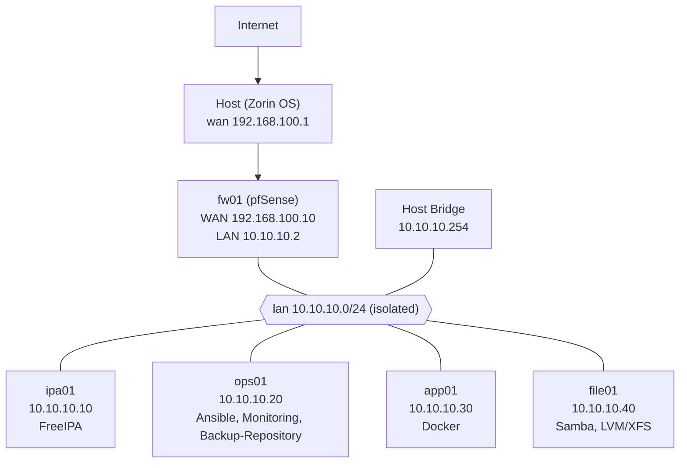

# Umgebung

## Überblick

Die Umgebung besteht aus fünf VMs auf einem Linux-Host mit KVM/QEMU und libvirt (Host: Zorin OS, 16 GB RAM, 4 vCPU, x86_64). Alle VMs verwenden statische IP-Adressen. DHCP und VPN werden nicht eingesetzt.

- Domain: `lab.internal`
- Kerberos Realm: `LAB.INTERNAL`
- Netze: `wan` (NAT, `192.168.100.0/24`) und `lan` (isolated, `10.10.10.0/24`)
- Gateway der Linux-VMs: `10.10.10.2` (fw01)
- DNS der Linux-VMs: `10.10.10.10` (ipa01), nach der FreeIPA-Client-Registrierung

## VMs und Aufgaben

| VM | Betriebssystem | Aufgaben |
|---|---|---|
| fw01 | pfSense CE 2.9 | Routing, NAT und Firewall zwischen `wan` und `lan` |
| ipa01 | Fedora Server 45 | FreeIPA (LDAP, Kerberos, DNS, CA), HBAC- und sudo-Regeln |
| ops01 | Fedora Server 45 | Ansible Control Node, Prometheus, Grafana, Loki, restic-Repository |
| app01 | Ubuntu Server 26.04 LTS | Docker Engine, Docker Compose (Gitea, PostgreSQL, Nginx mit TLS) |
| file01 | Ubuntu Server 26.04 LTS | LVM/XFS-Speicher, Samba-Dateiserver, restic-Client |

node_exporter und Grafana Alloy laufen auf ipa01, ops01, app01 und file01.

## Ressourcenplan

| VM | vCPU | RAM | Disk (qcow2) |
|---|---|---|---|
| fw01 | 1 | 1 GB | 10 GB |
| ipa01 | 2 | 3 GB | 20 GB |
| ops01 | 2 | 3 GB | 20 GB System + 20 GB Backup |
| app01 | 2 | 2 GB | 20 GB |
| file01 | 1 | 1,5 GB | 15 GB System + 2 × 10 GB (LVM) |
| **Summe** | 8 | 10,5 GB | 125 GB (thin provisioned) |

## IP-Plan

| Host | Netz | Adresse |
|---|---|---|
| Host (libvirt Bridge) | wan | `192.168.100.1/24` (Gateway) |
| fw01 | wan | `192.168.100.10/24` |
| fw01 | lan | `10.10.10.2/24` |
| ipa01 | lan | `10.10.10.10/24` |
| ops01 | lan | `10.10.10.20/24` |
| app01 | lan | `10.10.10.30/24` |
| file01 | lan | `10.10.10.40/24` |
| Host (libvirt Bridge) | lan | `10.10.10.254/24` (Verwaltungszugriff) |

## Netzwerktopologie

## Kurzbeschreibung

- fw01 ist das einzige Gateway. Auf `lan` sind nur DNS, NTP, HTTP, HTTPS und ICMP nach außen erlaubt. Auf `wan` gibt es keine Inbound-Regeln.
- ipa01 stellt Kerberos, LDAP und DNS für `lab.internal` bereit. ops01, app01 und file01 sind FreeIPA-Clients.
- ops01 steuert alle VMs mit Ansible. Prometheus sammelt Metriken von node_exporter. Grafana Alloy sendet Journal-Logs an Loki. Grafana zeigt beides an.
- app01 stellt Gitea hinter einem Nginx Reverse Proxy mit einem Zertifikat der FreeIPA-CA bereit.
- file01 stellt eine Samba-Freigabe auf LVM/XFS bereit. restic sichert die Daten nachts auf die separate Backup-Disk von ops01.
